Implementación y administración de un servidor web con Ubuntu Server y Nginx

Andrey Hegel Zafra Venegas

Luis Guillermo Quispe Alvarado

Estefano Alexis Ramirez Garcia

Maleck Adriano Ramirez Alvarez

Joselin Victoria Gutierrez Mamani

Grupo 7

Facultad de Ingeniería de Sistemas e Informática

Universidad Nacional Mayor de San Marcos

Taller de Construcción de Software Web

31 de octubre de 2026

Implementación y administración de un servidor web con Ubuntu Server y Nginx

En esta práctica implementamos un servidor web para publicar una página de presentación de la Universidad Nacional Mayor de San Marcos (UNMSM). Nuestro propósito fue comprobar el ciclo de administración del servicio: preparar el sistema operativo, configurar la red, publicar contenido, separar permisos, supervisar recursos, revisar registros y recuperar archivos desde una copia de seguridad.

Tomamos el portal institucional como referencia para la identidad visual y los enlaces de los servicios universitarios (Universidad Nacional Mayor de San Marcos [UNMSM], s. f.). La página del laboratorio conserva una estructura propia y utiliza recursos locales para que las imágenes y estilos no dependan de solicitudes externas durante su consulta.

El resultado comprende dos entornos. El primero es una máquina virtual real con Ubuntu Server y Nginx, donde ejecutamos las pruebas administrativas. El segundo es una copia estática publicada en GitHub Pages para facilitar la revisión mediante un enlace público. La publicación externa no reemplaza la evidencia del servidor Linux.

Objetivo y alcance

Nuestro objetivo general fue instalar, configurar y administrar un servidor web básico con Ubuntu Server y Nginx, aplicando procedimientos de supervisión, seguridad y mantenimiento. Para comprobarlo, seguimos las diez indicaciones de la actividad y respondimos sus cinco preguntas de análisis.

La solución publica contenido HTML, CSS y JavaScript. La actividad no exige una base de datos ni un sistema de autenticación, por lo que mantuvimos el alcance en la presentación de la universidad y en la administración del servidor. No implementamos formularios que reciban contraseñas institucionales.

Entorno y arquitectura

Creamos la máquina UNMSM-Web-Lab en VirtualBox 7.0.26. Utilizamos Ubuntu Server 24.04.5 LTS de 64 bits, 2048 MB de memoria, un procesador virtual y un disco de 20 GB. El sistema identificó el kernel Linux 6.8.0-147-generic y la plataforma de virtualización Oracle.

Configuramos la interfaz enp0s3 con la dirección estática 10.0.2.15/24 y la puerta de enlace 10.0.2.2. La red NAT de VirtualBox permite la salida del invitado. Para consultar el sitio desde Windows, redirigimos 127.0.0.1:8088 al puerto 80 de la VM; para la administración SSH, redirigimos 127.0.0.1:22022 al puerto 22. Ambos accesos del anfitrión están ligados a la interfaz de bucle local.

```bash
Navegador de Windows
  http://127.0.0.1:8088
       | NAT de VirtualBox
       v
  10.0.2.15:80 -> Nginx -> /var/www/unmsm/public

Administración: SSH 127.0.0.1:22022 -> 10.0.2.15:22
Publicación externa: GitHub Pages -> copia estática en docs/
```

Creación de la máquina virtual e instalación de Ubuntu Server

Preparamos Ubuntu a partir de una imagen oficial de servidor en formato VMDK. Verificamos su SHA-256 contra el archivo de sumas publicado por Canonical y después clonamos la imagen a un disco VDI de trabajo. De esta manera conservamos el archivo original y administramos una instalación independiente. La imagen utilizada fue noble-server-cloudimg-amd64.vmdk (Canonical, s. f.-c).

```bash
SHA-256 verificado:
9a1e3959c9f4ad9d4752101fd4ff9a43191fb7d72e61fa20e033f9fd235ce794
```

El aprovisionamiento inicial se realizó con cloud-init y un disco NoCloud denominado seed.iso. Incluimos user-data, meta-data y network-config para establecer el usuario administrador, el nombre del equipo, la red y los paquetes. NoCloud permite entregar esta configuración desde un medio local (Canonical, s. f.-b). No utilizamos el asistente interactivo del instalador ISO; la instalación se desplegó a partir de la imagen oficial de Ubuntu Server.

Durante el arranque inicial apareció un bloqueo relacionado con los temporizadores virtuales. Lo resolvimos dejando un procesador, habilitando HPET y manteniendo IO-APIC y el proveedor de paravirtualización predeterminado. Después del ajuste, Ubuntu completó el arranque y mostró el nombre web-unmsm, como se observa en la Figura 1.

Figura 1. Consola de Ubuntu Server en la máquina virtual

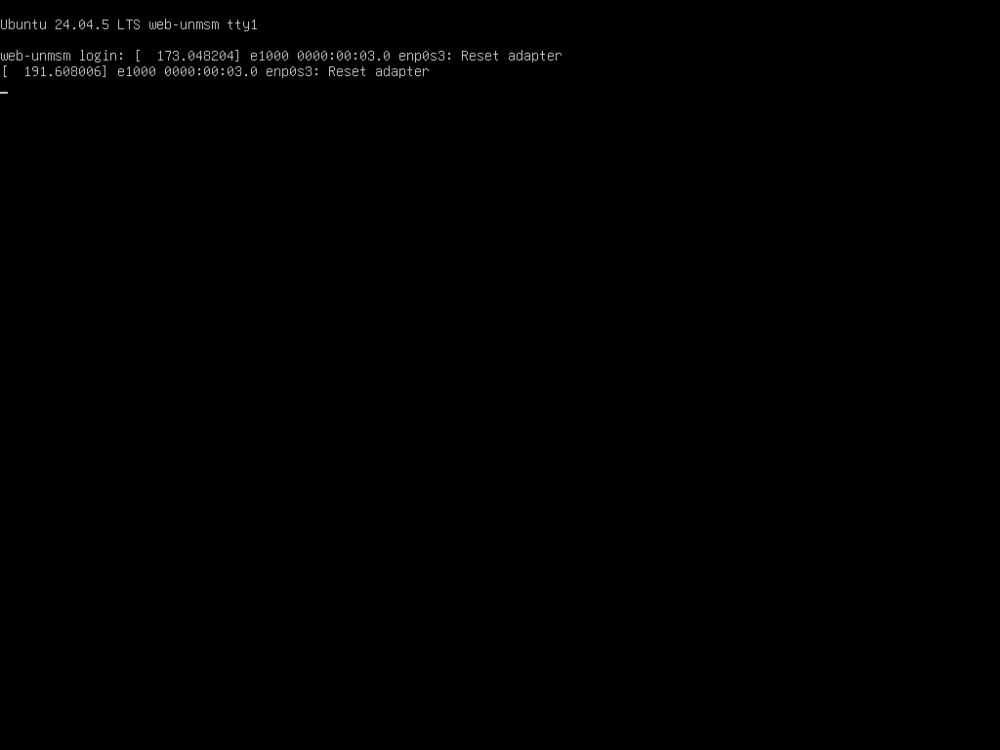

Nota. Captura directa de la pantalla de la VM después de arrancar. La administración posterior se realizó por SSH.

Configuración del nombre y la dirección de red

Asignamos el nombre web-unmsm y comprobamos la identidad con hostnamectl. Utilizamos Netplan para conservar la dirección estática y la ruta predeterminada. La Figura 2 reúne el sistema operativo, las direcciones, la ruta y la distribución del disco obtenidos desde la VM.

```bash
hostnamectl
ip -br address
ip route
sudo cat /etc/netplan/50-cloud-init.yaml
sudo netplan generate
```

La dirección DNS inicial de NAT, 10.0.2.3, no resolvía los nombres de los repositorios en este entorno. Probamos el servidor DNS de la red local, 192.168.18.1, y comprobamos la resolución de archive.ubuntu.com y una respuesta HTTP 200. Guardamos ese valor en Netplan. En otra red este DNS debe adaptarse; no corresponde copiarlo sin verificar que esté disponible.

Figura 2. Identidad del servidor, dirección estática y disco

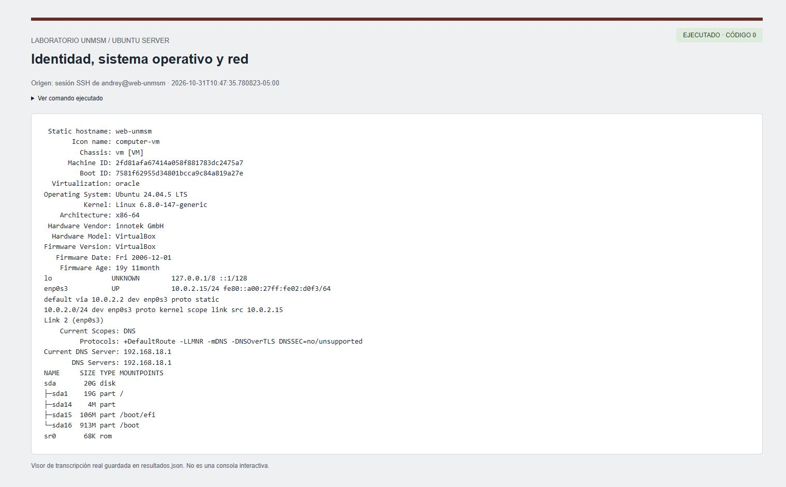

Nota. Captura del visor de resultados de una sesión SSH real. La transcripción íntegra está en evidencias/resultados.json.

Instalación y configuración de Nginx

Una vez corregida la resolución DNS, actualizamos el índice de paquetes e instalamos Nginx, ACL, curl y UFW mediante APT. El paquete instalado de Nginx fue 1.24.0-2ubuntu7.19. La documentación de Ubuntu describe la instalación del servidor desde los paquetes de la distribución (Canonical, s. f.-a).

```bash
sudo apt-get update
sudo apt-get install -y nginx acl curl ufw
sudo systemctl enable --now nginx
nginx -v
sudo nginx -t
```

Creamos /etc/nginx/sites-available/unmsm y lo habilitamos mediante un enlace en sites-enabled. Configuramos el puerto 80, la carpeta /var/www/unmsm/public y el archivo principal index.html. La directiva try_files devuelve 404 cuando el recurso no existe. La guía de Nginx explica el uso del bloque server, las ubicaciones y el directorio raíz para servir archivos estáticos (NGINX, s. f.).

```bash
server {
    listen 80 default_server;
    server_name web-unmsm localhost 127.0.0.1;
    root /var/www/unmsm/public;
    index index.html;
    location / { try_files $uri $uri/ =404; }
}
```

Antes de recargar el servicio ejecutamos nginx -t. El resultado indicó que la sintaxis era correcta y que la prueba fue satisfactoria. Después confirmamos active y enabled, además de la escucha en el puerto 80. La Figura 3 muestra estas comprobaciones; la configuración completa se encuentra en infra/unmsm.nginx.

Figura 3. Validación y estado del servicio Nginx

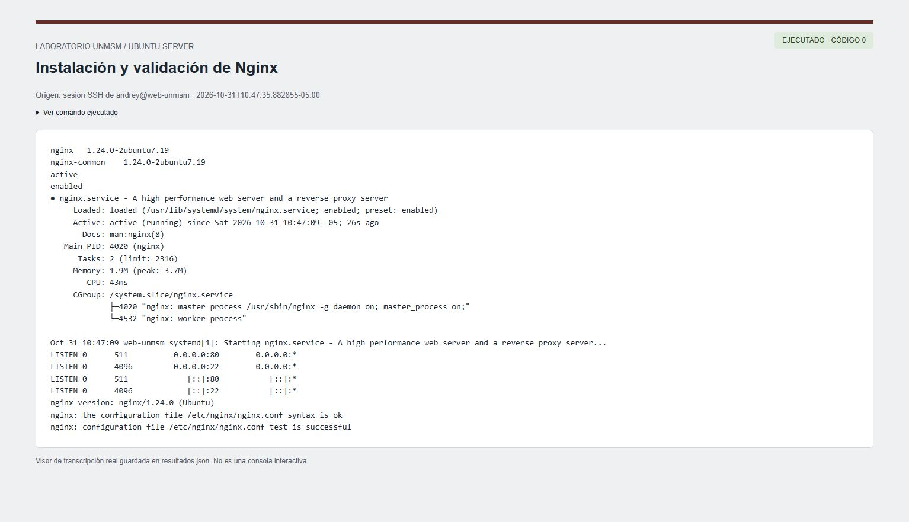

Nota. Salida real de nginx -t, systemctl y ss recogida mediante SSH.

Diseño y publicación de la página universitaria

Organizamos la web en presentación, identidad institucional, oferta académica, investigación, comunidad y contacto. Tomamos como referencia el encabezado granate del portal oficial, sus detalles dorados y el contraste de títulos con tipografía serif. Utilizamos un fondo de la Ciudad Universitaria y fotografías de actividades académicas de la UNMSM. La Figura 4 presenta el portal consultado como referencia visual (UNMSM, s. f.).

Figura 4. Portal institucional utilizado como referencia visual

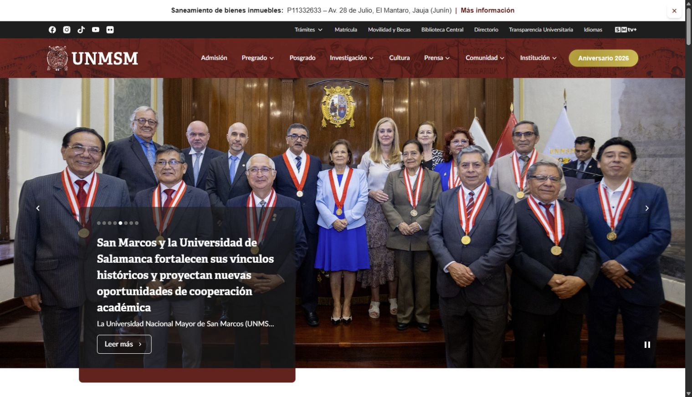

Nota. Captura de https://www.unmsm.edu.pe/, consultado el 31 de octubre de 2026. El portal y sus recursos gráficos pertenecen a la UNMSM.

Implementamos el sitio con HTML semántico, CSS y JavaScript sin un proceso de compilación. Separamos los estilos y el comportamiento en archivos externos, mantuvimos las imágenes en assets y añadimos textos alternativos, enlaces descriptivos, un acceso para saltar al contenido y estilos de foco visibles. En pantallas pequeñas, el menú se abre con un botón que actualiza aria-expanded y puede cerrarse con Escape.

Copiamos los archivos a /var/www/unmsm/public y aplicamos permisos al contenido. La portada publicada en Nginx se observa en la Figura 5. El pie de página identifica el carácter académico del proyecto y los botones de servicios remiten a sus destinos oficiales.

Figura 5. Portada de la página publicada en Nginx

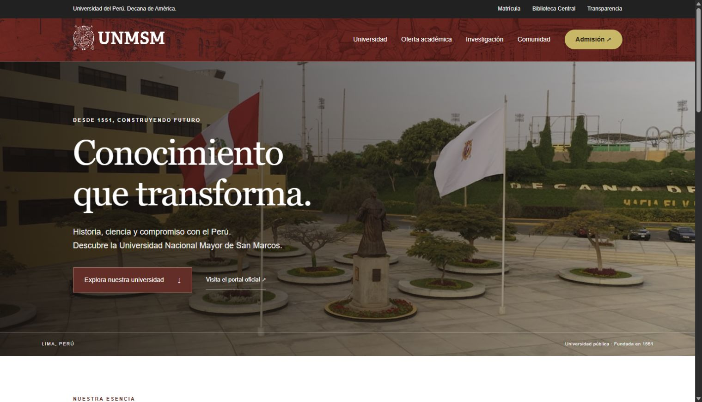

Nota. Captura del navegador al consultar http://127.0.0.1:8088/. Los recursos gráficos se sirven desde la VM.

Comprobación desde el navegador

Abrimos la dirección del anfitrión en Chrome y comprobamos que aparecieran el título, el escudo, las imágenes y las secciones. Los ocho enlaces internos apuntaban a identificadores existentes y las cuatro etiquetas de imagen completaron su carga. En la vista de escritorio no se detectó desbordamiento horizontal y no se registraron errores ni advertencias en la consulta de consola realizada durante esa prueba.

Probamos el enlace Oferta académica y comprobamos que desplazara la página hacia las cinco áreas de conocimiento, como se observa en la Figura 6. Además de la comprobación visual, utilizamos curl para verificar los códigos de respuesta y las cabeceras HTTP.

Figura 6. Navegación hacia la oferta académica

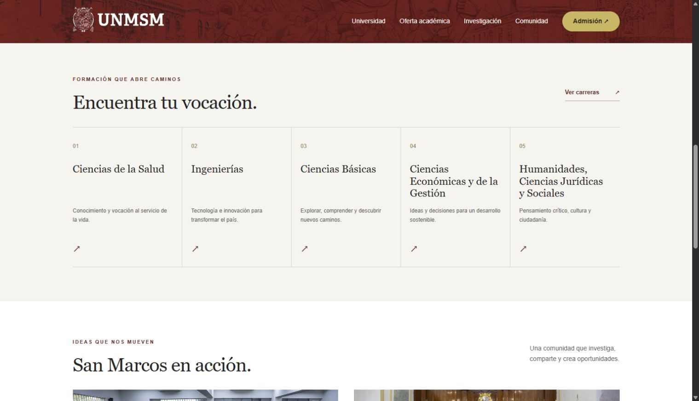

Nota. Captura del resultado de seleccionar el enlace de navegación en el sitio del laboratorio.

```bash
curl -I http://127.0.0.1/
# Resultado: HTTP/1.1 200 OK
curl -s -o /dev/null -w "%{http_code}\n" http://127.0.0.1/no-existe
# Resultado: 404
curl -s -o /dev/null -w "%{http_code}\n" http://127.0.0.1/.env
# Resultado: 403
```

La respuesta 200 confirmó que la portada fue atendida. La respuesta 404 demostró el manejo de una ruta inexistente. La respuesta 403 fue provocada de forma controlada para comprobar el bloqueo de archivos ocultos; no representa una caída del servidor. La Figura 7 muestra los tres resultados y las cabeceras aplicadas.

Figura 7. Respuestas HTTP y cabeceras del sitio

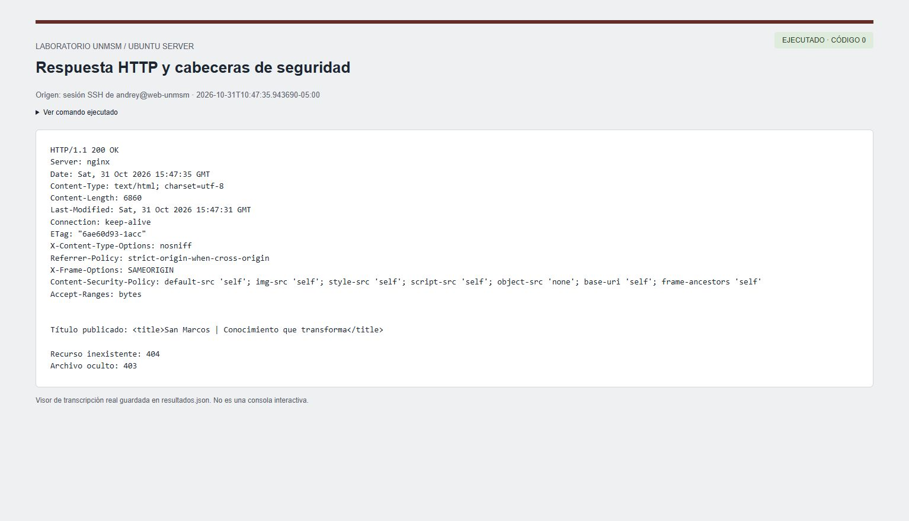

Nota. Transcripción real de las consultas curl ejecutadas dentro de Ubuntu.

Verificación del diseño móvil

Para revisar la adaptación del diseño cargamos temporalmente el sitio en un marco de 390 por 780 píxeles dentro de Chrome. Comprobamos la legibilidad de la portada y abrimos el menú; el estado accesible cambió de contraído a expandido y aparecieron los enlaces de navegación. Las Figuras 8 y 9 muestran ambas vistas. Esta es una prueba de tamaño de pantalla en el navegador, no una prueba realizada en un teléfono físico.

Figura 8. Vista de la página en un marco de 390 píxeles

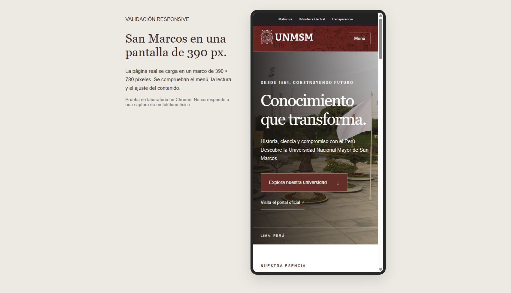

Nota. La página real se carga en el marco de prueba. Los archivos auxiliares se retiraron del servidor después de la revisión.

Figura 9. Menú de navegación abierto en la vista móvil

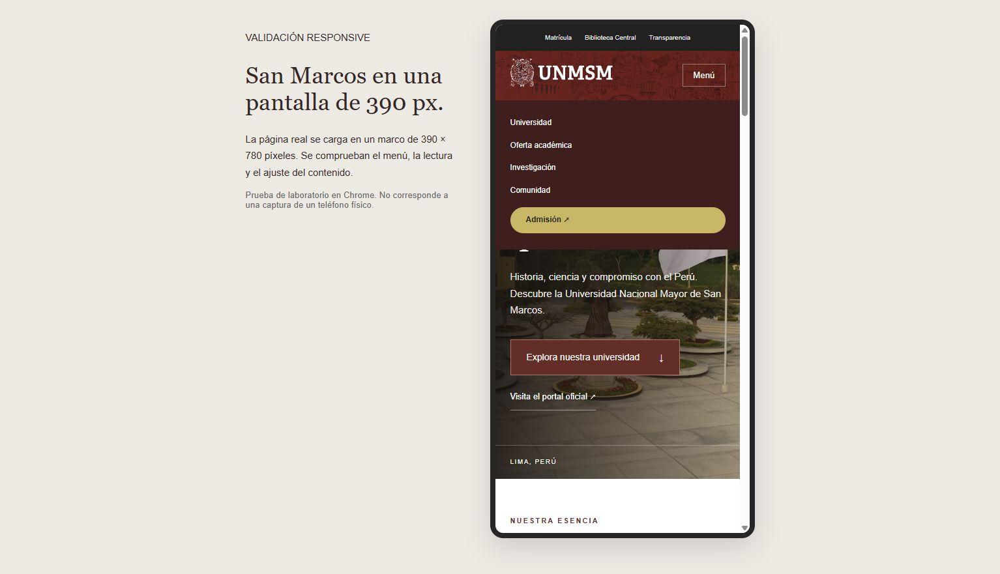

Nota. Captura posterior a pulsar Menú. El botón actualiza su estado aria-expanded.

Creación del usuario adicional y asignación de permisos

Creamos el grupo webeditors y el usuario editorweb para separar la edición del contenido de la administración del servidor. La cuenta editorweb recibió un directorio personal y una shell, pero no fue añadida a sudo. Conservamos su contraseña bloqueada y realizamos las pruebas de acceso desde la cuenta administradora con sudo -u editorweb.

```bash
sudo groupadd -f webeditors
sudo useradd -m -s /bin/bash -g webeditors editorweb
sudo usermod -aG webeditors andrey
sudo chown -R root:webeditors /var/www/unmsm/public
sudo find /var/www/unmsm/public -type d -exec chmod 2775 {} +
sudo find /var/www/unmsm/public -type f -exec chmod 664 {} +
```

El permiso 2775 de los directorios incluye el bit setgid, para que los nuevos elementos conserven el grupo de edición. Los archivos iniciales tienen permiso 664. Aplicamos ACL de lectura y acceso a directorios para www-data y ACL predeterminadas para conservar el acceso del grupo. La propiedad de los archivos de configuración de Nginx quedó en root, fuera del alcance de edición del usuario adicional.

Comprobamos tres situaciones. Primero, editorweb creó, leyó y eliminó un archivo de prueba dentro del sitio. Segundo, www-data no pudo escribir en el directorio publicado. Tercero, editorweb no pudo modificar la configuración de Nginx y sudo confirmó que no tenía autorización administrativa. La Figura 10 reúne los resultados de estas pruebas positivas y negativas.

Figura 10. Usuario editorweb y separación de permisos

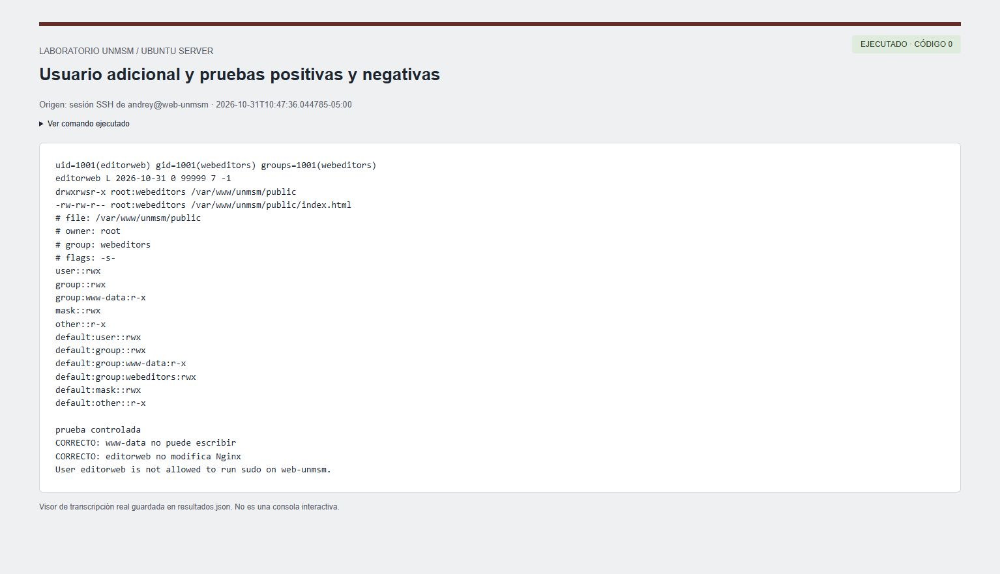

Nota. La prueba controlada de escritura se retiró al terminar. La salida de sudo -l confirma que editorweb no puede ejecutar sudo.

Supervisión de CPU, memoria y disco

Consultamos uptime, top, free, df y ps para observar el estado del servidor. En la medición de las 10:47:36, el sistema mostró aproximadamente 301 MiB de memoria utilizada y 1.6 GiB disponibles. La partición raíz utilizaba 1.9 GiB de 19 GiB, equivalente al 11 %. El contenido publicado ocupaba aproximadamente 1.5 MiB. La Figura 11 conserva la medición completa.

```bash
uptime
top -b -n 1 | head -n 12
free -h
df -h /
du -sh /var/www/unmsm/public
ps -C nginx -o pid,user,%cpu,%mem,cmd
```

La primera muestra de top reportó 88.9 % de CPU inactiva. Esta cifra es una observación puntual del laboratorio y no una prueba de capacidad bajo carga. El promedio de carga de un minuto fue 0.82 en una VM con un procesador. Los valores deben interpretarse junto con su evolución, porque una instalación reciente o una tarea de mantenimiento pueden elevar temporalmente la carga.

Identificamos el proceso maestro de Nginx con root y el proceso trabajador con www-data. Esta separación permite que el proceso que atiende las solicitudes no tenga permisos de escritura sobre los archivos publicados. Para una operación continua estableceríamos alertas de memoria disponible, espacio de disco, carga sostenida y errores del servicio; en esta práctica realizamos la inspección manual de esos indicadores.

Figura 11. Consumo de CPU, memoria, disco y procesos de Nginx

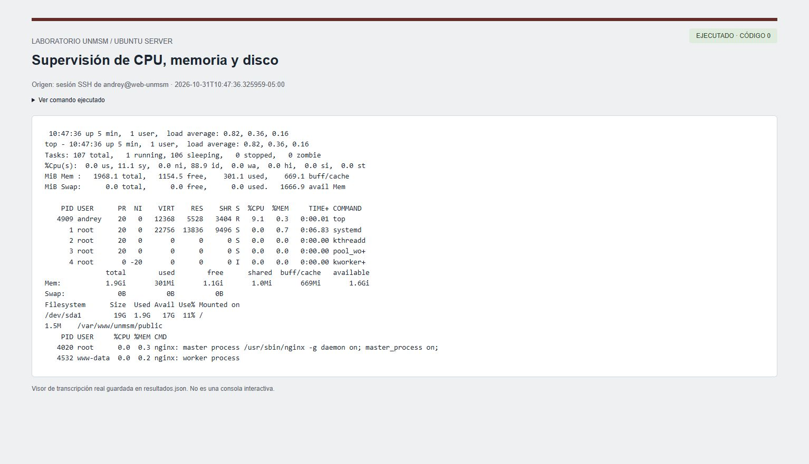

Nota. Medición real de la VM el 31 de octubre de 2026. No corresponde a un ensayo de rendimiento ni a una serie histórica.

Revisión de registros de actividad

Configuramos un registro de acceso específico, /var/log/nginx/unmsm_access.log, y un registro de errores, /var/log/nginx/unmsm_error.log. También consultamos journalctl para revisar los eventos de inicio y recarga del servicio. La Figura 12 muestra las solicitudes controladas y los eventos administrativos.

```bash
sudo tail -n 8 /var/log/nginx/unmsm_access.log
sudo tail -n 5 /var/log/nginx/unmsm_error.log
sudo journalctl -u nginx -n 5 --no-pager
```

En access.log identificamos la fecha y la hora, el método HTTP, la ruta, el protocolo, el código de respuesta y el agente de usuario. Las solicitudes de la portada generaron 200, la ruta /no-existe generó 404 y /.env generó 403. El error access forbidden by rule coincidió con la prueba de archivo oculto, por lo que pudimos relacionar el registro con una acción conocida.

La consulta de journalctl mostró que Nginx había iniciado y que la configuración se había recargado correctamente. Revisar los registros resulta útil para distinguir una falla de sintaxis, un problema de permisos y una solicitud inválida. La presencia de una entrada de error aislada no demuestra por sí misma que el servicio completo esté detenido.

Figura 12. Registros de acceso, rechazo controlado y eventos del servicio

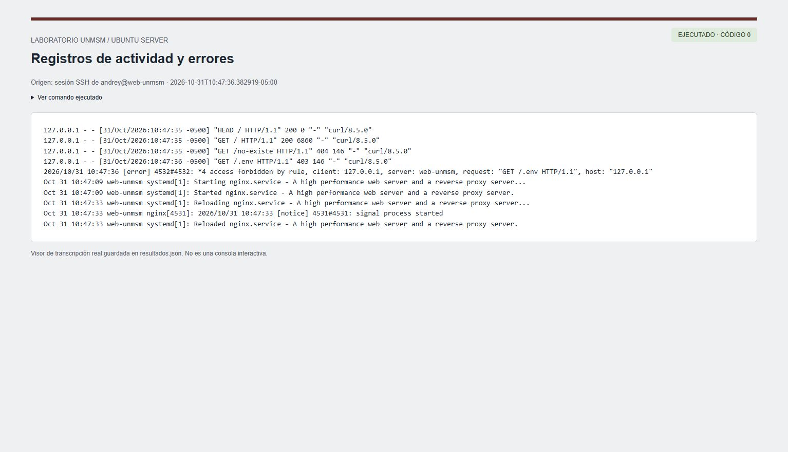

Nota. La solicitud a /.env fue generada para probar la regla de bloqueo; no se publicó ningún archivo de credenciales.

Copia de seguridad y restauración de prueba

Implementamos el guion /usr/local/sbin/backup-unmsm para respaldar /var/www/unmsm y /etc/nginx/sites-available/unmsm. La copia utiliza tar con compresión gzip y la opción --acls. El directorio /var/backups/unmsm tiene acceso restringido y umask 077 limita la lectura de los archivos nuevos al propietario.

```bash
sudo /usr/local/sbin/backup-unmsm
# Ejemplo de archivo creado:
# /var/backups/unmsm/unmsm-20261031-104736.tar.gz
# Se genera también un archivo .sha256
```

No nos limitamos a comprobar que existiera el archivo. Validamos la suma SHA-256, extrajimos el respaldo en una carpeta temporal y comparamos el contenido restaurado con el sitio original mediante diff -rq. La suma devolvió OK y la comparación terminó sin diferencias. La Figura 13 presenta la evidencia; la prueba verificó el contenido, mientras que la opción --acls se incluyó para conservar la información de permisos en el archivo.

```bash
cd /var/backups/unmsm
sudo sha256sum -c unmsm-20261031-104736.tar.gz.sha256
# Extracción de prueba en un directorio temporal:
sudo tar --acls -xzpf ARCHIVO.tar.gz -C DIRECTORIO_TEMPORAL
sudo diff -rq /var/www/unmsm/public \
    DIRECTORIO_TEMPORAL/var/www/unmsm/public
```

Programamos la ejecución diaria a las 02:00 mediante un servicio y un temporizador de systemd. Persistent=true permite ejecutar una copia pendiente después de volver a encender la máquina. El respaldo del laboratorio es local; no protege frente a la pérdida completa del disco virtual. Para un servicio real añadiríamos almacenamiento externo, retención de versiones y restauraciones periódicas.

Figura 13. Validación de integridad y restauración del respaldo

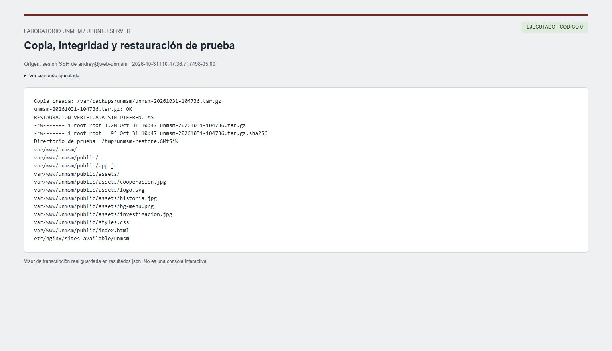

Nota. La salida RESTAURACION_VERIFICADA_SIN_DIFERENCIAS se emite únicamente después de que sha256sum y diff finalizan correctamente.

Medidas de seguridad y mantenimiento

Habilitamos UFW después de autorizar OpenSSH y Nginx HTTP. La política observada fue denegar conexiones entrantes no permitidas y aceptar las salientes. Dentro de la VM se admiten los puertos 22 y 80; la publicación de estos puertos en Windows continúa limitada a 127.0.0.1 por la configuración NAT. La Figura 14 muestra el firewall activo y la copia programada.

```bash
sudo ufw allow OpenSSH
sudo ufw allow 'Nginx HTTP'
sudo ufw --force enable
sudo ufw status verbose
systemctl list-timers unmsm-backup.timer
```

Deshabilitamos el listado de directorios y la exposición de la versión de Nginx, bloqueamos las rutas ocultas y añadimos cabeceras X-Content-Type-Options, Referrer-Policy, X-Frame-Options y Content-Security-Policy. El sitio utiliza sus propios archivos de estilos, scripts e imágenes, por lo que la política de contenido permite limitar estos recursos al mismo origen. El acceso HTTP del laboratorio no cuenta con un certificado TLS; la copia pública de GitHub Pages se consulta mediante HTTPS.

Figura 14. Firewall activo y programación de la copia diaria

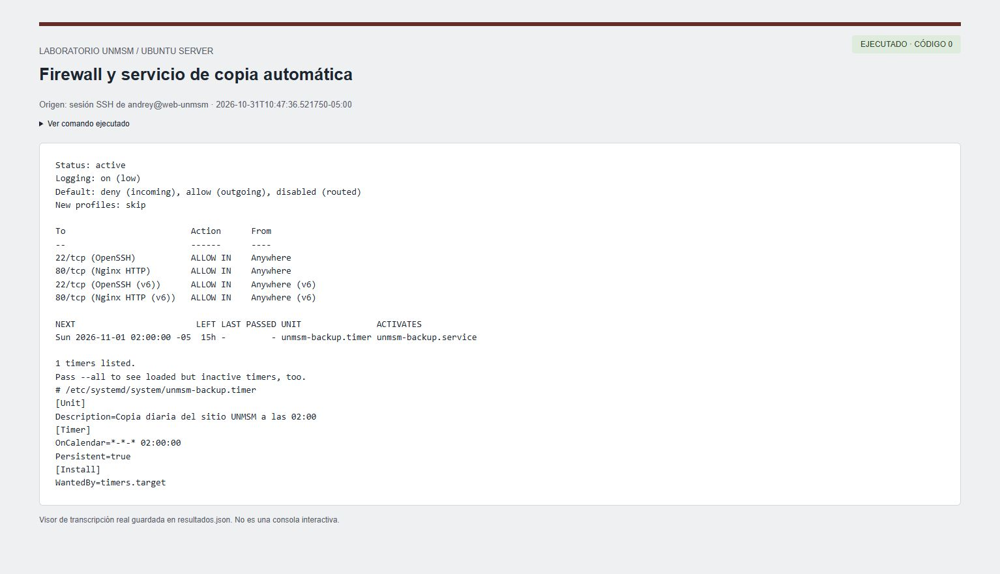

Nota. La consulta del temporizador muestra la siguiente ejecución prevista para las 02:00 del día siguiente.

Reiniciamos Ubuntu y volvimos a consultar el nombre, la dirección y los servicios. Nginx quedó active y enabled, el temporizador quedó active, la interfaz mantuvo 10.0.2.15/24 y curl devolvió 200. Guardamos esta comprobación en evidencias/reinicio.json. Esto demuestra la persistencia de la configuración tras un reinicio; no constituye una prueba de tolerancia a fallos de infraestructura.

Publicación del proyecto y enlace de revisión

Publicamos el código fuente en el repositorio Andrey3210/unmsm-servidor-web. Organizamos dist como fuente del sitio, infra para la configuración y los guiones, evidencias para los resultados e informe para el documento técnico. Excluimos las claves privadas, los discos virtuales y los archivos de ejecución que no forman parte de la entrega.

Configuramos GitHub Pages para publicar desde la rama main y la carpeta /docs, que contiene una copia de los archivos del sitio. Este procedimiento coincide con las opciones de publicación documentadas por GitHub (s. f.). La finalidad de este segundo despliegue es que el profesor pueda revisar la página sin depender de que la VM del laboratorio permanezca encendida.

Sitio público: https://andrey3210.github.io/unmsm-servidor-web/

Repositorio: https://github.com/Andrey3210/unmsm-servidor-web

La Figura 15 muestra la portada consultada en el enlace público después de completar el despliegue.

Figura 15. Página disponible mediante GitHub Pages

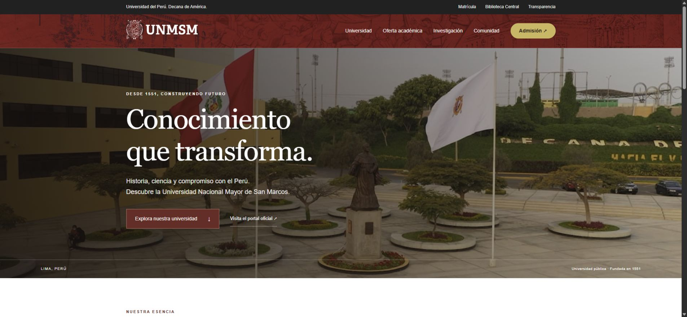

Nota. Captura del sitio público. Las pruebas de usuarios, permisos, recursos y respaldos corresponden al servidor Ubuntu del laboratorio.

Respuestas a las preguntas de análisis

¿Por qué es importante supervisar permanentemente los servidores?

La supervisión permite detectar condiciones que pueden interrumpir el servicio antes de que afecten a todos los usuarios. Por ejemplo, un disco cercano a su capacidad puede impedir la escritura de registros, mientras que una reducción sostenida de memoria disponible puede generar lentitud o terminar procesos. Un servicio puede continuar respondiendo durante una degradación inicial, por lo que observar únicamente si la portada abre resulta insuficiente.

En la práctica comprobamos CPU, memoria, disco, procesos y estado de Nginx. Para una supervisión permanente complementaríamos estas consultas con mediciones históricas y alertas. También diferenciaríamos una variación puntual de un problema sostenido: una muestra de CPU durante una actualización no demuestra que el servidor sea incapaz de atender solicitudes.

¿Qué consecuencias puede ocasionar una mala administración de permisos?

Un exceso de permisos permite que una cuenta de edición modifique configuraciones sensibles o que una vulnerabilidad en el servicio altere el contenido publicado. Un acceso insuficiente también produce problemas: si el proceso trabajador no puede leer index.html, una página válida puede devolver un error. Por eso, la configuración debe permitir las operaciones necesarias y denegar las demás.

La prueba con editorweb confirmó que se puede delegar la modificación del contenido sin conceder sudo ni escritura sobre Nginx. La prueba con www-data verificó que el proceso del servicio puede atender archivos sin poder modificarlos. Aplicar permisos 777 habría eliminado esa separación y ampliado innecesariamente las posibilidades de alteración del sitio.

¿Qué sucede cuando un servidor web deja de funcionar?

Los usuarios pierden el acceso al contenido o reciben errores de conexión. El mensaje concreto depende del punto de falla: si Nginx está detenido, la conexión puede ser rechazada; si un intermediario no alcanza al servidor de origen, puede devolver un error de puerta de enlace; si solo falta un archivo, puede aparecer 404 sin que todo el servidor haya caído. La consecuencia funcional es la interrupción parcial o total de los servicios que dependen de esa publicación.

Para investigar una interrupción revisaríamos primero el estado de systemd, después la sintaxis de Nginx, la escucha del puerto, la red y los registros. No reiniciaríamos repetidamente sin revisar la causa. En esta práctica no provocamos una caída deliberada de Nginx; comprobamos su recuperación automática después de reiniciar la VM y diferenciamos las respuestas 403 y 404 de una indisponibilidad general.

¿Por qué es necesario realizar copias de seguridad?

Las copias permiten recuperar archivos ante una eliminación accidental, una modificación incorrecta o una pérdida del sistema. El código del sitio y la configuración del servidor forman una unidad de recuperación: restaurar únicamente index.html no reconstruye necesariamente el servicio. Además, un archivo comprimido que nunca se ha probado puede resultar incompleto o inutilizable cuando se necesita.

Por ese motivo respaldamos el contenido y la configuración, calculamos SHA-256 y realizamos una extracción de prueba. La comparación sin diferencias demuestra que ese respaldo concreto contenía los archivos esperados. Para una protección mayor mantendríamos copias fuera de la VM y definiríamos cuánto tiempo conservarlas, cuánto dato es aceptable perder y cuánto debe tardar la recuperación.

¿Qué ventajas ofrece administrar servidores de manera remota?

La administración remota permite revisar y mantener un servidor sin estar frente a su consola física. Una conexión SSH facilita consultar registros, transferir archivos y ejecutar procedimientos repetibles. En este laboratorio administramos Ubuntu desde Windows a través de una redirección local, lo que permitió documentar comandos y resultados sin instalar un escritorio gráfico en el servidor.

También mejora la trazabilidad cuando se conservan las transcripciones y se utilizan cuentas diferenciadas. Estas ventajas requieren proteger el acceso: mantuvimos autenticación por clave para la cuenta administradora y no publicamos el puerto SSH en Internet. La cuenta editorweb quedó separada de las funciones administrativas. La comodidad del acceso remoto no justifica conceder privilegios amplios a todos los usuarios.

Incidencias y decisiones adoptadas

La primera incidencia fue un bloqueo del kernel durante el arranque de VirtualBox. Conservamos la imagen oficial verificada y ajustamos los temporizadores virtuales y el número de procesadores. La configuración final utiliza un procesador, HPET habilitado, IO-APIC habilitado y el proveedor de paravirtualización predeterminado. No fue necesario modificar el kernel de Ubuntu.

La segunda incidencia fue la resolución DNS del invitado. cloud-init registró un error durante su primer intento de instalar paquetes. Corregimos el DNS en Netplan y completamos la actualización e instalación con APT. El estado histórico de cloud-init conserva ese fallo inicial; por ello verificamos el resultado efectivo con dpkg-query, nginx -t, systemctl, curl y una prueba posterior al reinicio, en lugar de afirmar que el aprovisionamiento inicial no había tenido errores.

La tercera decisión fue separar el enlace público de la infraestructura administrativa. GitHub Pages permite revisar el diseño, pero no ejecuta las cuentas, los permisos ni los respaldos de la VM. Las evidencias del informe identifican cuál entorno se está comprobando en cada caso para evitar atribuir a GitHub Pages resultados obtenidos en Ubuntu.

Conclusiones

Implementamos una máquina virtual con Ubuntu Server, una dirección estática y un servidor Nginx que publica la página de presentación de la UNMSM. Comprobamos su acceso desde el navegador y mediante HTTP, y verificamos que Nginx y la dirección permanecieran configurados después de reiniciar el sistema.

La separación entre root, webeditors, editorweb y www-data permitió delegar la edición del contenido sin conceder administración del servidor. Las pruebas positivas y negativas demostraron los permisos efectivos, más allá de la lectura de sus valores numéricos.

La revisión de recursos y registros permitió relacionar el estado del sistema con las solicitudes de prueba. La creación de un respaldo, la verificación de su suma y la comparación de los archivos restaurados cerraron el ciclo básico de mantenimiento. La copia local y la supervisión puntual satisfacen el alcance del laboratorio, aunque una operación de producción requiere respaldo externo, retención y monitoreo continuo.

El repositorio conserva los archivos del proyecto y las instrucciones para reproducirlo. La publicación estática ofrece un enlace de revisión independiente del equipo del laboratorio, mientras que las capturas y transcripciones documentan la administración real de Ubuntu Server y Nginx.

Referencias

American Psychological Association. (s. f.). Student paper setup guide. https://apastyle.apa.org/instructional-aids/student-paper-setup-guide.pdf

Canonical. (s. f.-a). Install and configure Nginx. Ubuntu. https://ubuntu.com/tutorials/install-and-configure-nginx

Canonical. (s. f.-b). NoCloud. cloud-init documentation. https://docs.cloud-init.io/en/26.1/reference/datasources/nocloud.html

Canonical. (s. f.-c). Ubuntu 24.04 LTS (Noble Numbat) daily. Ubuntu Cloud Images. Recuperado el 31 de octubre de 2026, de https://cloud-images.ubuntu.com/noble/current/

GitHub. (s. f.). Creating a GitHub Pages site. GitHub Docs. https://docs.github.com/en/pages/getting-started-with-github-pages/creating-a-github-pages-site

NGINX. (s. f.). Beginner’s guide. https://nginx.org/en/docs/beginners_guide.html

Universidad Nacional Mayor de San Marcos. (s. f.). Universidad Nacional Mayor de San Marcos. Recuperado el 31 de octubre de 2026, de https://www.unmsm.edu.pe/

Apéndice A

Guía de reproducción y archivos de entrega

Para reproducir el laboratorio, crearíamos una VM con Ubuntu Server de 64 bits, 2 GB de RAM y un disco de 20 GB. Configuraríamos la red y ajustaríamos el DNS al entorno disponible. Después instalaríamos nginx, acl, curl y ufw; copiaríamos dist e infra a /home/andrey/lab y ejecutaríamos administrar.sh. La ruta asume una cuenta administrativa llamada andrey y debe modificarse cuando se use otro nombre.

```bash
sudo hostnamectl set-hostname web-unmsm
sudo apt-get update
sudo apt-get install -y nginx acl curl ufw
bash /home/andrey/lab/infra/administrar.sh
sudo nginx -t
systemctl is-active nginx
curl -I http://127.0.0.1/
```

Los archivos principales son dist/index.html, dist/styles.css y dist/app.js; la configuración del servidor está en infra/unmsm.nginx. El guion infra/administrar.sh aplica el despliegue y los permisos, mientras que backup-unmsm.sh y las unidades unmsm-backup.service y unmsm-backup.timer implementan las copias. verificar.py conserva los resultados administrativos en JSON.

Las capturas de los comandos se obtuvieron desde un visor de las transcripciones reales de SSH. Este visor mejora la lectura, pero no representa una consola interactiva. Los archivos resultados.json, reinicio.json y despliegue.json conservan los comandos, las salidas y sus códigos. La consola de Ubuntu y las páginas del navegador se capturaron directamente de sus interfaces.

Para la presentación del documento utilizamos la guía oficial de trabajos estudiantiles de APA: márgenes de 2.54 cm, Times New Roman de 12 puntos, doble espacio en el texto, sangría de primera línea de 1.27 cm y numeración superior derecha. Las referencias utilizan sangría francesa; las figuras incluyen número, título y nota explicativa (American Psychological Association, s. f.).

Apéndice B

Configuración completa del sitio Nginx

La siguiente configuración corresponde al archivo instalado en sites-available. El sitio predeterminado de la VM fue sustituido por el enlace hacia esta configuración.

```bash
server {
    listen 80 default_server;
    listen [::]:80 default_server;
    server_name web-unmsm localhost 127.0.0.1;
    root /var/www/unmsm/public;
    index index.html;
    charset utf-8;
    server_tokens off;
    autoindex off;
    access_log /var/log/nginx/unmsm_access.log;
    error_log /var/log/nginx/unmsm_error.log warn;
    add_header X-Content-Type-Options nosniff always;
    add_header Referrer-Policy strict-origin-when-cross-origin always;
    add_header X-Frame-Options SAMEORIGIN always;
    add_header Content-Security-Policy "default-src 'self'; img-src 'self'; style-src 'self'; script-src 'self'; object-src 'none'; base-uri 'self'; frame-ancestors 'self'" always;
    location / { try_files $uri $uri/ =404; }
    location ~ /\. { deny all; }
}

```
